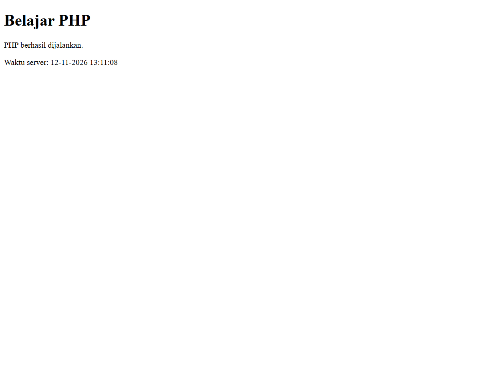
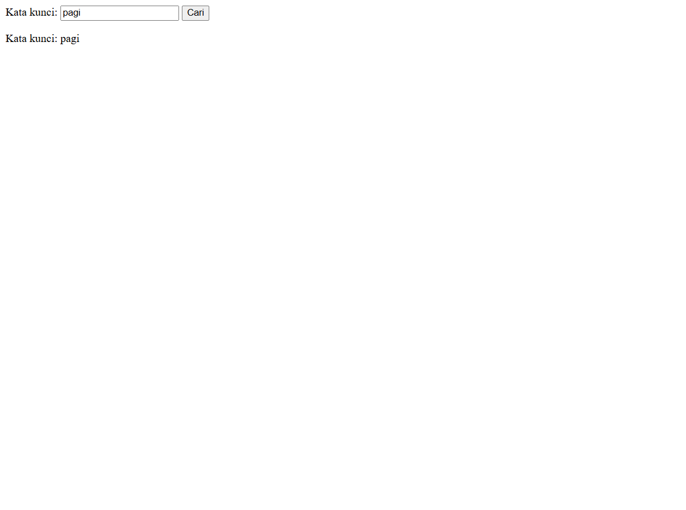
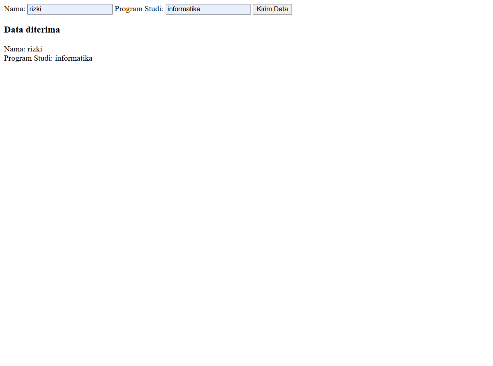
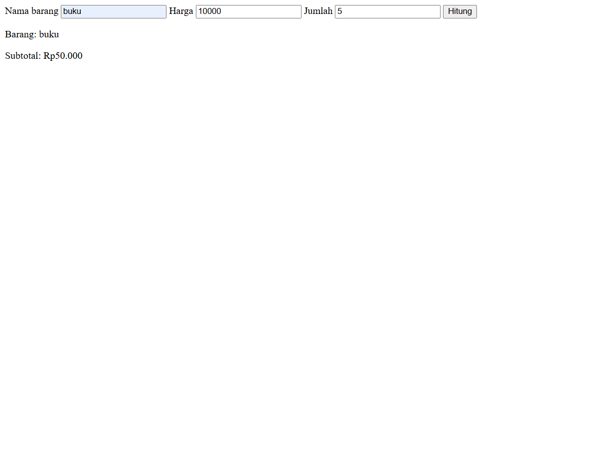
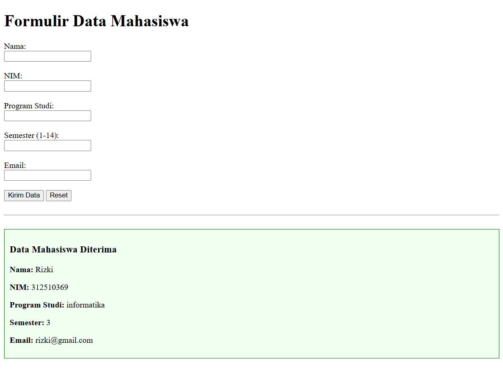
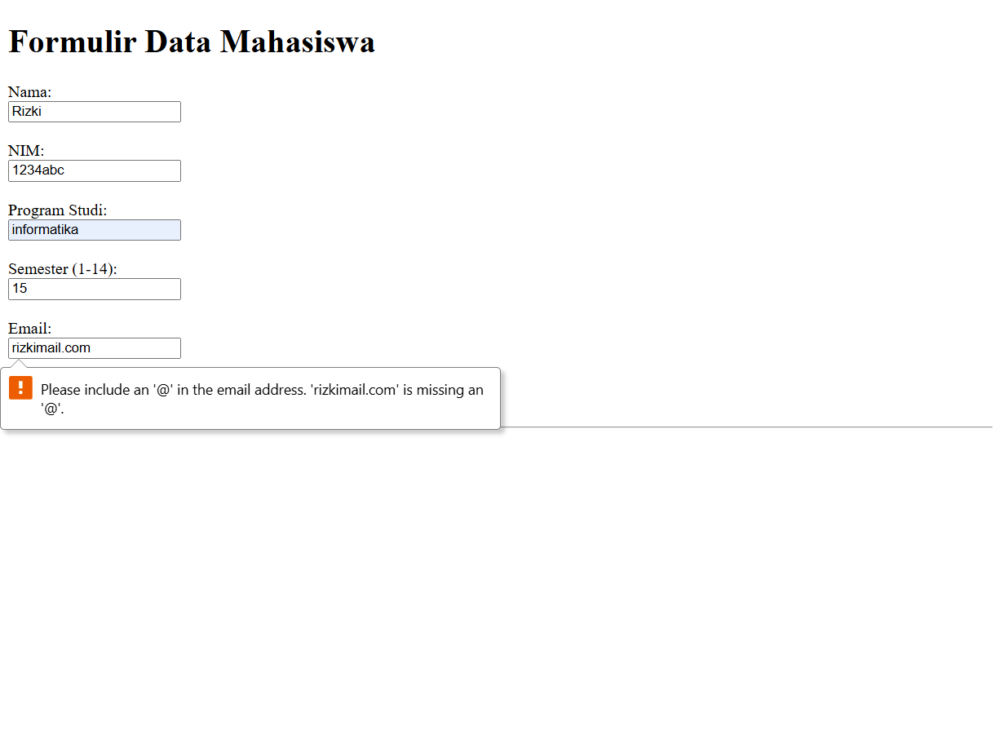

# Lab7Web_PHP - Praktikum 7: Pemrograman Server-Side dengan PHP

**Nama:** Rizki Dwi Ananta  
**NIM:** 312510369  
**Kelas:** I251D  
**Mata Kuliah:** Pemrograman Web  

## 1. Tujuan Praktikum
- Memahami perbedaan pemrosesan client-side dan server-side.
- Mengenali sintaks PHP dan menjalankan file PHP melalui server lokal.
- Menggunakan variabel, tipe data, operator, percabangan, perulangan, dan function.
- Menerima dan memproses data dari form HTML menggunakan metode GET dan POST.
- Melakukan validasi dan sanitasi input dasar sebelum data ditampilkan atau diproses.
- Membangun aplikasi sederhana yang menerima, memproses, dan menampilkan data pengguna.

## 2. Perangkat yang Digunakan
- Laptop/PC
- Web Browser (Google Chrome / Mozilla Firefox)
- Visual Studio Code (Editor Teks)
- XAMPP / Laragon (PHP & Web Server Apache)
- Sistem Operasi: Windows

## 3. Cara Menjalankan Server Lokal
1. Pastikan folder proyek `Lab7Web_PHP` sudah diletakkan di dalam direktori web server (misalnya: `C:\xampp\htdocs\Lab7Web_PHP`).
2. Buka aplikasi **XAMPP Control Panel**.
3. Klik tombol **Start** pada modul **Apache** untuk menyalakan web server.
4. Buka web browser dan akses alamat: `http://localhost/Lab7Web_PHP/`
5. **Penting:** Jangan membuka file `.php` dengan cara klik ganda (double-click) dari folder Windows, karena kode PHP tidak akan dieksekusi.

## 4. Struktur File & Direktori
Berikut adalah pemetaan struktur direktori proyek (Tree Diagram) beserta keterangannya:

Lab7Web_PHP/
│
├── index.php               # Latihan 1: Menjalankan PHP
├── latihan2.php            # Latihan 2: Variabel, Operator, & Percabangan
├── latihan3.php            # Latihan 3: Perulangan & Array
├── latihan4.php            # Latihan 4: Membuat Function (Diskon)
├── latihan5.php            # Latihan 5: Memproses Form dengan GET
├── latihan6.php            # Latihan 6: Memproses Form dengan POST
├── latihan7.php            # Latihan 7: Pengolahan Data Sederhana
├── mini_project.php        # Mini Project: Formulir Validasi Data Mahasiswa
│
├── Eksperimen Mandiri/     # Folder tugas eksperimen mandiri
│   ├── eksperimen1.php     # Rata-rata nilai
│   ├── eksperimen2.php     # Pencarian array dengan GET
│   ├── eksperimen3.php     # Function format Rupiah
│   ├── eksperimen4.php     # Validasi NIM (Angka & Panjang)
│   └── eksperimen5.php     # Tombol Reset
│
├── img/                    # Penyimpanan gambar screenshot
│   ├── ss_latihan1.png
│   ├── ss_latihan2.png
│   ├── ss_latihan3.png
│   ├── ss_latihan4.png
│   ├── ss_latihan5.png
│   ├── ss_latihan6.png
│   ├── ss_latihan7.png
│   ├── ss_mini_valid.png
│   └── ss_mini_error.png
│
└── README.md               # Dokumentasi Proyek (File ini)

## 5. Ringkasan Hasil
Latihan Wajib:

Latihan 1: PHP berhasil dijalankan di server lokal dan berhasil menampilkan waktu server secara dinamis.

Latihan 2: Logika percabangan (if-elseif-else) berhasil menentukan predikat (A, B, C, D) berdasarkan perhitungan bobot nilai.

Latihan 3: Array mahasiswa berhasil ditampilkan dalam bentuk daftar berurutan (ordered list) menggunakan perulangan foreach.

Latihan 4: Function hitungDiskon() berhasil dibuat dan mengembalikan nilai akhir setelah dipotong diskon.

Latihan 5 & 6: Form GET berhasil mengirim data melalui URL, sedangkan form POST mengirim data secara tersembunyi dan berhasil divalidasi di sisi server.

Latihan 7: Validasi input (harga harus angka, jumlah harus bilangan bulat positif) berhasil mencegah error perhitungan.

Mini Project: Formulir mahasiswa berhasil memvalidasi kolom kosong, format email, dan rentang semester (1-14). Data ditampilkan dengan aman menggunakan htmlspecialchars().

Eksperimen Mandiri:

Eksperimen 1: Berhasil menambahkan perhitungan nilai rata-rata dari tiga komponen nilai (Tugas, UTS, UAS).

Eksperimen 2: Berhasil memodifikasi form GET agar dapat mencari nama dari array data sederhana menggunakan fungsi stripos().

Eksperimen 3: Berhasil membuat function formatRupiah() untuk mengubah format angka menjadi format mata uang Rupiah secara otomatis.

Eksperimen 4: Berhasil menambahkan validasi NIM pada Mini Project agar hanya berisi angka dan memiliki panjang yang ditentukan (9 digit) menggunakan ctype_digit() dan strlen().

Eksperimen 5: Berhasil menambahkan tombol Reset pada form. Tombol ini hanya membersihkan input di browser (client-side), berbeda dengan pemrosesan ulang (submit) yang akan mengirim ulang data ke server.

## 6. Kasus Uji (Mini Project)
A. Kasus Input Valid:

Data Lengkap: Nama diisi "Rizki", NIM "312510369", Prodi "Informatika", Semester "3", Email "rizki@mail.com".

Hasil: Ringkasan data mahasiswa berhasil ditampilkan.

Batas Semester: Nama diisi "Andi", NIM "123456789", Prodi "Sistem Informasi", Semester "14" (batas maksimal), Email "andi@kampus.ac.id".

Hasil: Ringkasan data mahasiswa berhasil ditampilkan.

B. Kasus Input Tidak Valid:

Format Email Salah: Mengisi email dengan format "rizki[at]mail.com" atau tanpa @.

Hasil: Sistem menolak dan menampilkan pesan "Format email tidak valid."

Semester di Luar Rentang: Mengisi semester dengan angka "0" atau "15".

Hasil: Sistem menolak dan menampilkan pesan "Semester harus berupa angka 1–14."

Validasi NIM (Eksperimen 4): Mengisi NIM dengan huruf (misal "1234abc") atau kurang dari 9 digit (misal "123").

Hasil: Sistem menolak dan menampilkan pesan "NIM harus berupa angka dan tepat 9 digit."

Kolom Kosong (Bypass Required): Mengosongkan kolom Nama atau NIM (dengan cara menghapus atribut required via Inspect Element).

Hasil: Sistem mendeteksi dan menampilkan pesan "Nama wajib diisi." (Membuktikan validasi server-side tetap berjalan).

## 7. Dokumentasi Output (Screenshot)
Berikut adalah bukti tangkapan layar (screenshot) dari setiap latihan yang telah dijalankan melalui server lokal (localhost).

Mini Project - Formulir Data Mahasiswa
1. Tampilan Saat Data Valid:

2. Tampilan Saat Terjadi Error:
